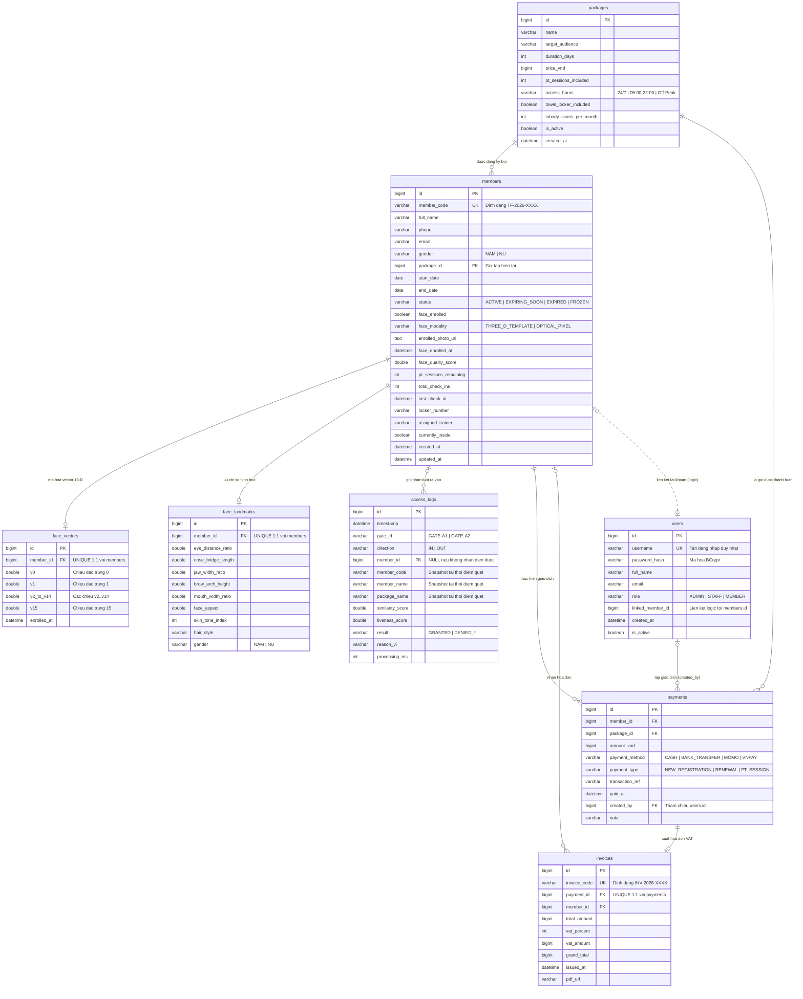

# Sơ Đồ Thực Thể Liên Kết (ERD) & Thiết Kế Cơ Sở Dữ Liệu SQL — TitanFit Biometrics

> Cơ sở dữ liệu **MySQL 8** (`titanfit_db`) được thiết kế đồng bộ 100% với các JPA Entities trong `titanfit-backend/src/main/java/com/titanfit/entity/`.
> File SQL DDL đầy đủ để chạy trực tiếp hoặc import vào MySQL Workbench / DBeaver: [titanfit_db_schema.sql](./titanfit_db_schema.sql).

---

## 1. Sơ Đồ ERD Trực Quan (Entity Relationship Diagram)

---

## 2. Chi Tiết Các Bảng & Ràng Buộc Nghiệp Vụ

| STT | Tên bảng | Loại quan hệ chính | Khóa chính (PK) & Khóa ngoại (FK) | Mô tả nghiệp vụ |
| :---: | :--- | :--- | :--- | :--- |
| 1 | `users` | `1 - N` tới `payments` | PK: `id`, UK: `username` | Lưu tài khoản hệ thống (`ADMIN`, `STAFF`, `MEMBER`). Áp dụng chính sách **Dual-Admin** (tối đa 2 tài khoản `ADMIN`: `admin1`, `admin2`). |
| 2 | `packages` | `1 - N` tới `members`, `payments` | PK: `id` | Danh mục gói tập (1 tháng, 3 tháng, 6 tháng + PT, 12 tháng VIP) gồm giá, khung giờ tập, số buổi PT, InBody. |
| 3 | `members` | `N - 1` tới `packages` `1 - 1` tới `face_vectors`, `face_landmarks` | PK: `id`, UK: `member_code` FK: `package_id` | Hồ sơ hội viên phòng gym, trạng thái thẻ (`ACTIVE`, `EXPIRING_SOON`, `EXPIRED`, `FROZEN`) và trạng thái có đang ở trong phòng hay không (`currently_inside`). |
| 4 | `face_vectors` | `1 - 1` tới `members` | PK: `id` FK & UK: `member_id` | Lưu vector đặc trưng sinh trắc học **16 chiều (`v0`..`v15`)** đã chuẩn hóa L2 để đối chiếu Cosine Similarity tại cổng xoay. |
| 5 | `face_landmarks` | `1 - 1` tới `members` | PK: `id` FK & UK: `member_id` | Lưu tỷ lệ hình học khuôn mặt bổ trợ (khoảng cách mắt, sống mũi, xương hàm, tông da, kiểu tóc). |
| 6 | `access_logs` | `N - 1` (nullable) tới `members` | PK: `id` FK: `member_id` | Lưu lịch sử quét Face ID qua cổng (`IN`/`OUT`), điểm Similarity, điểm Liveness, thời gian xử lý (`ms`) và lý do từ chối. Cho phép `member_id = NULL` khi phát hiện khách vãng lai lạ mặt. |
| 7 | `payments` | `N - 1` tới `members`, `packages`, `users` | PK: `id` FK: `member_id`, `package_id`, `created_by` | Ghi nhận giao dịch thu tiền đăng ký mới, gia hạn hoặc mua thêm buổi PT qua tiền mặt, chuyển khoản, MoMo, VNPay. |
| 8 | `invoices` | `1 - 1` tới `payments` `N - 1` tới `members` | PK: `id`, UK: `invoice_code` FK & UK: `payment_id`, FK: `member_id` | Lưu hóa đơn VAT (mặc định 10%), tổng tiền trước/sau thuế và đường dẫn file PDF hóa đơn. |

---

## 3. Cách Import SQL Để Tạo Bảng Hoặc Vẽ Diagram Trong MySQL Workbench

Nếu muốn mở sơ đồ ERD trực tiếp bằng **MySQL Workbench** hoặc **DBeaver** để xuất ảnh cho báo cáo Word:

1. Mở **MySQL Workbench** $\rightarrow$ kết nối tới MySQL Server (`localhost:3306`).
2. Chọn **File $\rightarrow$ Run SQL Script...** $\rightarrow$ chọn file `docs/titanfit_db_schema.sql` để tạo database `titanfit_db` và toàn bộ 8 bảng.
3. Chọn **Database $\rightarrow$ Reverse Engineer...** $\rightarrow$ chọn database `titanfit_db` $\rightarrow$ nhấn Next liên tục để MySQL Workbench tự sinh sơ đồ ERD có đầy đủ đường nối 1-1 / 1-N.
