# BÁO CÁO THI GIỮA KỲ — PHẦN 1: KIẾN TRÚC HỆ THỐNG
## Đề tài: TitanFit Biometrics — Hệ Thống Quản Lý Hội Viên & Kiểm Soát Ra Vào Bằng Face ID
**Nhóm thực hiện:** Nhóm 10  
**Môn học:** Đồ Án Chuyên Ngành Phần Mềm (ĐACNPM)

---

## 1. Tổng Quan Kiến Trúc Hệ Thống

Hệ thống **TitanFit Biometrics** được xây dựng theo kiến trúc **Client - Server phân tầng hiện đại (Multi-Tier Architecture)** kết hợp với **Module Nhận diện Sinh trắc học Thời gian thực (Real-Time Biometric Gateway)**. Kiến trúc được thiết kế tối ưu hóa cho độ trễ cực thấp (< 150ms) nhằm phục vụ mở cổng xoay tự động và kiểm soát luồng hội viên mật độ cao tại phòng gym.

Toàn bộ hệ thống được container hóa bằng **Docker & Docker Compose** để triển khai đồng bộ, khép kín và độc lập.

---

## 2. Sơ Đồ Kiến Trúc Hệ Thống (System Architecture Diagram)

```mermaid
flowchart TD
    subgraph CLIENT_LAYER["1. TẦNG TRÌNH DIỄN (CLIENT LAYER - WEB & KIOSK)"]
        UI_SPA["Ứng dụng SPA (React 19 + TypeScript + Vite)"]
        UI_GATE["Trạm Cổng Tự Động Kiosk (Gate Terminal View)"]
        UI_ADMIN["Bảng Điều Khiển Quản Trị (Admin & Staff Portal)"]
        UI_CANVAS["Bộ Xử Lý Quang Học Client (HTML5 Canvas 160x160 + Liveness Check)"]
        UI_LOCALSTORAGE["Bộ Nhớ Lưu Trữ Bền Vững Client (LocalStorage Persistence)"]
        
        UI_GATE --> UI_CANVAS
        UI_SPA --- UI_GATE
        UI_SPA --- UI_ADMIN
        UI_SPA --- UI_LOCALSTORAGE
    end

    subgraph NETWORK_GATEWAY["2. TẦNG CỔNG KẾT NỐI & ĐIỀU HƯỚNG (REVERSE PROXY & GATEWAY)"]
        NGINX["Nginx Web Server / Reverse Proxy (Port 80/3000)"]
        CORS["Bộ Lọc CORS & Bảo Mật Header"]
        NGINX --- CORS
    end

    subgraph BACKEND_LAYER["3. TẦNG DỊCH VỤ NGHIỆP VỤ (BACKEND APPLICATION - SPRING BOOT 3)"]
        SEC["Spring Security + JWT Authentication Filter"]
        
        subgraph CONTROLLERS["REST Controllers Layer"]
            CTRL_AUTH["AuthController (/api/auth)"]
            CTRL_MEMBER["MemberController (/api/members)"]
            CTRL_GATE["GateController (/api/gate)"]
            CTRL_LOG["AccessLogController (/api/logs)"]
            CTRL_PKG["PackageController (/api/packages)"]
            CTRL_DASH["DashboardController (/api/dashboard)"]
        end

        subgraph SERVICES["Business Logic & Service Layer"]
            SRV_AUTH["AuthService (Dual-Admin Security Policy)"]
            SRV_MEMBER["MemberService (Hồ sơ, Gói tập, Đóng băng)"]
            SRV_GATE["GateAccessService (Quyết định mở/khóa cổng xoay)"]
            SRV_BIO["BiometricService (Cosine Similarity 16-D, L2 Normalize)"]
            SRV_DASH["DashboardService (Thống kê lưu lượng & Doanh thu)"]
        end

        subgraph REPOSITORIES["Data Access Layer (Spring Data JPA / Hibernate)"]
            REPO_USER["UserRepository"]
            REPO_MEMBER["MemberRepository"]
            REPO_VECTOR["FaceVectorRepository"]
            REPO_LANDMARK["FaceLandmarksRepository"]
            REPO_LOG["AccessLogRepository"]
            REPO_PKG["PackageRepository"]
            REPO_PAY["PaymentRepository"]
            REPO_INV["InvoiceRepository"]
        end

        SEC --> CONTROLLERS
        CTRL_AUTH --> SRV_AUTH
        CTRL_MEMBER --> SRV_MEMBER
        CTRL_GATE --> SRV_GATE
        CTRL_GATE --> SRV_BIO
        CTRL_LOG --> REPO_LOG
        CTRL_PKG --> REPO_PKG
        CTRL_DASH --> SRV_DASH

        SERVICES --> REPOSITORIES
    end

    subgraph DATABASE_LAYER["4. TẦNG DỮ LIỆU & LƯU TRỮ (PERSISTENCE LAYER)"]
        MYSQL[("MySQL 8.0 Database (titanfit_db)")]
        REPOSITORIES --> MYSQL
    end

    subgraph HARDWARE_LAYER["5. TẦNG THIẾT BỊ NGOẠI VI & PHẦN CỨNG (HARDWARE / IOT)"]
        CAM["Webcam HD / Depth Camera 1080p"]
        TURNSTILE["Cổng Xoay Tự Động Tripod Turnstile (A1 & A2)"]
        LED["Đèn Tín Hiệu LED & Còi Báo (Xanh: OPEN / Đỏ: LOCK)"]
    end

    CAM -->|"Luồng Video Trực Tiếp 60FPS"| UI_CANVAS
    UI_SPA -->|"Yêu cầu HTTP REST / JSON (JWT Bearer Token)"| NGINX
    NGINX -->|"Chuyển tiếp API (Proxy Pass :8080)"| SEC
    SRV_GATE -->|"Tín hiệu Điều khiển Cổng (OPEN_GREEN / LOCK_RED)"| TURNSTILE
    SRV_GATE --> LED
```

---

## 3. Mô Tả Chi Tiết Các Tầng Kiến Trúc

### 3.1. Tầng Trình Diễn (Client / Presentation Layer)
- **Công nghệ**: React 19, TypeScript, Tailwind CSS v4, Lucide Icons, Vite 8.
- **Vai trò**:
  - Giao diện người dùng đơn trang (SPA) phản hồi cao, tương thích cả màn hình Desktop phòng điều hành và màn hình cảm ứng Kiosk tại cửa vào.
  - **Trạm Kiểm Soát Cổng (Gate Terminal)**: Kết nối trực tiếp webcam máy tính thông qua `navigator.mediaDevices.getUserMedia`, trích xuất khung hình khuôn mặt tại tọa độ trung tâm (vùng tỷ lệ vàng 60% khuôn mặt) bằng thẻ HTML5 Canvas 160x160 pixels.
  - **Trích xuất Vector Đặc trưng 16-D tại Client**: Thuật toán quét bề mặt điểm ảnh (Pixel Topography) tính toán 16 giá trị đặc trưng khuôn mặt (độ sáng vi sai vùng mắt, sống mũi, gò má, cằm) và kiểm tra tính sống động (Liveness Detection $\ge 80\%$) để chống giả mạo bằng hình ảnh điện thoại.
  - **Lưu trữ bền vững (LocalStorage Persistence)**: Tự động đồng bộ toàn bộ dữ liệu hội viên, ảnh snapshot và lịch sử quẹt cổng vào LocalStorage, đảm bảo khi tắt trình duyệt hoặc mất điện đột ngột dữ liệu vẫn còn nguyên vẹn.

### 3.2. Tầng Cổng Kết Nối & Điều Hướng (Reverse Proxy & Gateway)
- **Công nghệ**: Nginx Server, CORS Filter.
- **Vai trò**:
  - Đóng vai trò là reverse proxy tiếp nhận các luồng truy cập tại cổng `80`/`3000`, phân phối tài nguyên tĩnh Frontend và điều hướng các API `/api/*` về máy chủ ứng dụng Spring Boot tại cổng `8080`.
  - Thiết lập cơ chế CORS (Cross-Origin Resource Sharing) an toàn, ngăn chặn tấn công giả mạo yêu cầu qua mạng.

### 3.3. Tầng Dịch Vụ Nghiệp Vụ (Backend Application Layer)
- **Công nghệ**: Spring Boot 3.2.5 (Java 17), Spring Security 6, JJWT (Java JWT).
- **Cấu trúc 3 phân lớp tiêu chuẩn**:
  1. **REST Controller**: Tiếp nhận yêu cầu HTTP RESTful, xác thực cú pháp dữ liệu (DTO Bean Validation), trích xuất thông tin định danh từ JWT token.
  2. **Service Layer**:
     - `AuthService`: Xử lý đăng nhập, cấp phát JWT 24h và thực thi **Chính sách Dual-Admin** (giới hạn tối đa đúng 02 tài khoản Quản trị viên trong hệ thống: `admin1`, `admin2`).
     - `MemberService`: Nghiệp vụ thêm, sửa, xóa, tìm kiếm, kích hoạt gói tập, đóng băng thẻ và phân công PT/tủ đồ.
     - `BiometricService`: Thực thi thuật toán chuẩn hóa vector L2 Normalization và tính toán độ tương đồng **Cosine Similarity** ($\text{Cosine} \in [0, 100\%]$).
     - `GateAccessService`: Trái tim ra quyết định đóng/mở cổng xoay:
       $$\text{Quyết định Cổng} = (\text{Liveness} \ge 80\%) \land (\text{Cosine Similarity} \ge 86\%) \land (\text{Trạng thái Gói} = \text{ACTIVE})$$
  3. **Repository Layer**: Sử dụng Spring Data JPA / Hibernate kết nối cơ sở dữ liệu MySQL, tối ưu hóa truy vấn bằng Index.

### 3.4. Tầng Dữ Liệu & Lưu Trữ (Persistence Layer)
- **Công nghệ**: MySQL 8.0 Community Server.
- **Cơ sở dữ liệu**: `titanfit_db` (bảng mã `utf8mb4_unicode_ci`).
- Gồm 8 bảng liên kết chặt chẽ: `users`, `packages`, `members`, `face_vectors`, `face_landmarks`, `access_logs`, `payments`, `invoices`.

### 3.5. Tầng Thiết Bị Ngoại Vi (Hardware / IoT Layer)
- **Webcam / Camera sinh trắc học**: Thu nhận luồng hình ảnh khuôn mặt của hội viên khi tiến vào vùng cảm ứng trước cổng xoay.
- **Cổng xoay Tripod Turnstile**: Nhận tín hiệu điều khiển điện tử relay (`OPEN_GREEN` / `LOCK_RED`) từ hệ thống để mở chốt xoay cho hội viên bước qua hoặc kích hoạt chuông cảnh báo khi phát hiện xâm nhập trái phép.
