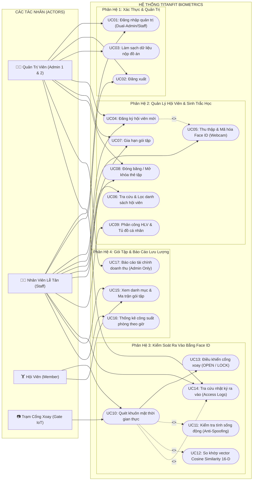

# BÁO CÁO THI GIỮA KỲ — PHẦN 2: LƯỢC ĐỒ USE CASE
## Đề tài: TitanFit Biometrics — Hệ Thống Quản Lý Hội Viên & Kiểm Soát Ra Vào Bằng Face ID
**Nhóm thực hiện:** Nhóm 10  
**Môn học:** Đồ Án Chuyên Ngành Phần Mềm (ĐACNPM)

---

## 1. Tổng Quan Về Các Tác Nhân (Actors)

Hệ thống **TitanFit Biometrics** xác định 4 tác nhân chính tham gia tương tác:

| STT | Tác nhân (Actor) | Vai trò & Trách nhiệm |
| :---: | :--- | :--- |
| 1 | **Quản Trị Viên (Admin)** | Cố định tối đa đúng 2 tài khoản (`admin1` - Trưởng, `admin2` - Phó) theo chính sách Dual-Admin. Có toàn quyền quản trị cao nhất: xem báo cáo doanh thu tài chính, cấu hình danh mục gói tập, làm sạch dữ liệu để nộp bài, quản lý hội viên và phân quyền nhân viên. |
| 2 | **Nhân Viên Lễ Tân (Staff)** | Nhân viên trực quầy (`staff01`). Có nhiệm vụ tiếp đón khách, đăng ký tài khoản hội viên mới, hướng dẫn quét camera thu thập Face ID, gia hạn gói tập, đóng băng/mở khóa thẻ và giám sát màn hình cổng xoay. |
| 3 | **Hội Viên Phòng Gym (Member)** | Khách hàng tập luyện tại phòng gym. Trực tiếp đứng trước trạm kiểm soát để camera nhận diện khuôn mặt và bước qua cổng xoay tự động; xem thông tin gói tập và hạn sử dụng. |
| 4 | **Trạm Cổng Tự Động (Gate Terminal / IoT)** | Tác nhân hệ thống / thiết bị phần cứng. Bao gồm Webcam nhận diện, cảm biến hồng ngoại, bo mạch điều khiển cổng xoay Tripod Turnstile và đèn còi cảnh báo. |

---

## 2. Sơ Đồ Use Case Tổng Thể Hệ Thống (Use Case Diagram)

---

## 3. Phân Rã Các Phân Hệ Chức Năng

### 3.1. Phân hệ 1: Xác Thực & Quản Trị Hệ Thống (Auth & Admin)
- **UC01: Đăng nhập quản trị**: Xác thực tài khoản Admin (`admin1`, `admin2`) và Nhân viên Lễ tân (`staff01`) bằng JWT token 24 giờ.
- **UC02: Đăng xuất**: Hủy phiên làm việc, xóa JWT khỏi client storage và khóa các tab bảo mật.
- **UC03: Làm sạch dữ liệu nộp đồ án**: Cho phép Quản trị viên khôi phục nhanh về **7 kịch bản hội viên chuẩn mực** hoặc xóa trắng dữ liệu để phục vụ hội đồng chấm thi đánh giá.

### 3.2. Phân hệ 2: Quản Lý Hội Viên & Sinh Trắc Học Face ID
- **UC04: Đăng ký hội viên mới**: Tiếp nhận thông tin cá nhân (họ tên, số điện thoại, giới tính, gói tập) có bảo vệ phân quyền.
- **UC05: Thu thập & Mã hóa Face ID**: Bắt buộc kích hoạt Webcam trên biểu mẫu đăng ký, chụp ảnh khuôn mặt thực tế, trích xuất vector 16-D chuẩn hóa L2 và gắn vĩnh viễn vào hồ sơ hội viên.
- **UC06: Tra cứu & Lọc hội viên**: Tìm kiếm tức thì theo họ tên, số điện thoại, lọc theo trạng thái thẻ (Đang hoạt động, Sắp hết hạn, Quá hạn, Đóng băng).
- **UC07: Gia hạn gói tập**: Gia hạn thời hạn sử dụng gói tập cho hội viên khi hết hạn.
- **UC08: Đóng băng / Mở khóa thẻ**: Tạm dừng gói tập khi hội viên có việc bận, tự động khóa cổng xoay nếu hội viên cố tình check-in.

### 3.3. Phân hệ 3: Kiểm Soát Cổng Tự Động (Core Gate Access)
- **UC10: Quét khuôn mặt thời gian thực**: Camera tự động bắt khung hình hội viên tiến vào vùng quét (< 150ms).
- **UC11: Kiểm tra Liveness (Anti-Spoofing)**: Đánh giá độ phản xạ và cấu trúc bề mặt điểm ảnh để ngăn chặn dùng ảnh in hoặc điện thoại giả mạo (yêu cầu $\ge 80\%$).
- **UC12: So khớp Cosine Similarity**: So sánh vector quang học 16 chiều với toàn bộ hội viên trong cơ sở dữ liệu (yêu cầu $\ge 86\%$).
- **UC13: Điều khiển cổng xoay**: Gửi lệnh điện áp mở chốt (`OPEN_GREEN`) nếu hợp lệ, hoặc khóa chặt (`LOCK_RED`) và báo lý do tiếng Việt lên màn hình.
- **UC14: Ghi nhật ký Access Logs**: Tự động lưu chi tiết mọi lượt quét gồm: ID cổng, hướng (`IN`/`OUT`), điểm tương đồng, liveness, thời gian xử lý và kết quả xác thực.

### 3.4. Phân hệ 4: Danh Mục Gói Tập & Thống Kê Lưu Lượng
- **UC15: Xem danh mục & Ma trận gói tập**: Hiển thị bảng so sánh đối đầu 8 tính năng chi tiết của 4 hạng thẻ (Cơ bản, Nâng cao, Hình thể + PT, VIP 12 tháng).
- **UC16: Thống kê công suất phòng theo giờ**: Biểu đồ phân tích lưu lượng hội viên các khung giờ trong ngày (cao điểm 17:30 - 19:30).
- **UC17: Báo cáo tài chính doanh thu**: Hiển thị riêng cho Quản trị viên tổng doanh thu thực thu, gói tập bán chạy nhất và tỷ lệ chuyển đổi hội viên.

---

## 4. Đặc Tả Chi Tiết 3 Use Case Cốt Lõi (Use Case Specifications)

### 4.1. Đặc tả Use Case UC10: Quét Khuôn Mặt & Mở Cổng Xoay Tự Động
- **Mã Use Case**: `UC10`
- **Tên Use Case**: Quét nhận diện khuôn mặt và điều khiển cổng xoay tự động.
- **Tác nhân chính**: Hội Viên Phòng Gym, Trạm Cổng Tự Động.
- **Mục tiêu**: Xác thực danh tính sinh trắc học và kiểm tra gói tập của hội viên để đóng/mở cổng tự động.
- **Tiền điều kiện**: 
  - Trạm camera tại cổng xoay đang hoạt động và truyền luồng video ổn định.
  - Hội viên đã được cấp mã hội viên và thu thập dữ liệu Face ID trong hệ thống.
- **Hậu điều kiện**:
  - Nếu hợp lệ: Cổng xoay nhả chốt cơ khí (đèn xanh), tổng số lượt check-in của hội viên tăng 1, trạng thái `currently_inside = true`.
  - Nếu không hợp lệ: Cổng xoay khóa chặt (đèn đỏ), còi báo hiệu kích hoạt và hiển thị lý do từ chối lên màn hình.
  - Một bản ghi nhật ký mới được lưu vào bảng `access_logs`.
- **Luồng sự kiện chính (Main Flow)**:
  1. Hội viên bước vào vùng quét trước camera của cổng xoay A1 hoặc A2.
  2. Camera trích xuất khung hình khuôn mặt tại vùng trung tâm 160x160 pixels.
  3. Hệ thống tính toán điểm chống giả mạo Liveness Score.
  4. Hệ thống trích xuất vector đặc trưng 16-D và tính toán Cosine Similarity đối chiếu với cơ sở dữ liệu hội viên.
  5. Hệ thống tìm thấy hồ sơ hội viên trùng khớp (Similarity $\ge 86\%$).
  6. Hệ thống kiểm tra thời hạn gói tập: gói tập đang ở trạng thái `ACTIVE` và trong khung giờ cho phép.
  7. Hệ thống phát tín hiệu `OPEN_GREEN`: nhả chốt cổng xoay, hiển thị lời chào kèm họ tên và ảnh đại diện hội viên.
  8. Hội viên đẩy cổng xoay bước vào phòng tập.
  9. Hệ thống tự động ghi nhật ký mở cổng thành công vào bảng `access_logs`.
- **Luồng sự kiện phụ (Alternative Flows)**:
  - *A1 - Phát hiện giả mạo (Spoofing)*: Điểm Liveness $< 80\%$ $\rightarrow$ Khóa cổng `LOCK_RED`, thông báo: *"Phát hiện ảnh giả mạo / Màn hình điện thoại"*, ghi nhận kết quả `DENIED_LIVENESS`.
  - *A2 - Gói tập hết hạn (Expired)*: Khuôn mặt nhận diện chính xác nhưng ngày hiện tại $> \text{endDate}$ $\rightarrow$ Khóa cổng `LOCK_RED`, thông báo: *"Gói tập đã hết hạn. Vui lòng liên hệ Lễ tân gia hạn"*, ghi nhận kết quả `DENIED_EXPIRED`.
  - *A3 - Thẻ đang đóng băng (Frozen)*: Trạng thái thẻ là `FROZEN` $\rightarrow$ Khóa cổng `LOCK_RED`, thông báo: *"Thẻ hội viên đang tạm ngưng"*, ghi nhận kết quả `DENIED_FROZEN`.
  - *A4 - Khách chưa đăng ký (Unrecognized)*: Điểm tương đồng $< 86\%$ $\rightarrow$ Khóa cổng `LOCK_RED`, hiển thị thông báo: *"Khuôn mặt chưa đăng ký trong hệ thống"*, hiển thị nút cho Lễ tân đăng ký nhanh.

---

### 4.2. Đặc tả Use Case UC04: Đăng Ký Hội Viên Mới & Thu Thập Face ID
- **Mã Use Case**: `UC04`
- **Tên Use Case**: Đăng ký hội viên mới và thu thập dữ liệu khuôn mặt thời gian thực.
- **Tác nhân chính**: Nhân Viên Lễ Tân, Quản Trị Viên.
- **Mục tiêu**: Tạo mới hồ sơ hội viên hợp lệ kèm vector sinh trắc học bắt buộc trong một quy trình duy nhất.
- **Tiền điều kiện**: Nhân viên hoặc Quản trị viên đã đăng nhập vào hệ thống (có JWT token).
- **Hậu điều kiện**: Tạo thành công mã hội viên mới dạng `TF-2026-XXXX`, tạo vector 16-D trong `face_vectors` và lưu vĩnh viễn vào bộ nhớ LocalStorage / MySQL.
- **Luồng sự kiện chính (Main Flow)**:
  1. Nhân viên bấm nút **"Đăng Ký Hội Viên"** trên giao diện chính.
  2. Hệ thống kiểm tra quyền hạn đăng nhập và mở biểu mẫu **"Đăng Ký Hội Viên Mới"**.
  3. Nhân viên nhập các trường thông tin: Họ và tên, Số điện thoại, Email, Giới tính, Gói tập đăng ký, HLV hướng dẫn.
  4. Hệ thống tự động bật Webcam trước mặt khách hàng tại quầy lễ tân.
  5. Khách hàng nhìn thẳng vào khung hình hướng dẫn trên màn hình.
  6. Hệ thống quét bề mặt điểm ảnh, hiển thị khung căn chỉnh màu xanh lá cây khi khuôn mặt hợp lệ và trích xuất vector 16-D.
  7. Nhân viên bấm **"Lưu & Kích Hoạt Thẻ"**.
  8. Hệ thống mã hóa vector, gán hạn sử dụng theo gói tập đã chọn và lưu hồ sơ hội viên.
  9. Hệ thống thông báo thành công và cập nhật ngay vào bảng danh sách hội viên.

---

### 4.3. Đặc tả Use Case UC01: Đăng Nhập Quản Trị Hệ Thống (Dual-Admin / Staff)
- **Mã Use Case**: `UC01`
- **Tên Use Case**: Đăng nhập quản trị hệ thống phân quyền.
- **Tác nhân chính**: Quản Trị Viên, Nhân Viên Lễ Tân.
- **Tiền điều kiện**: Ứng dụng đang chạy và người dùng chưa đăng nhập.
- **Luồng sự kiện chính (Main Flow)**:
  1. Người dùng bấm nút **"Đăng Nhập Quản Trị"** trên góc phải thanh Header.
  2. Hệ thống hiển thị Modal đăng nhập với 3 nút đăng nhập nhanh 1-Click phục vụ chấm thi đồ án (`admin1`, `admin2`, `staff01`) và form nhập thông tin thủ công.
  3. Người dùng chọn tài khoản hoặc nhập tên đăng nhập và mật khẩu.
  4. Hệ thống kiểm tra thông tin xác thực:
     - Nếu là `admin1` hoặc `admin2`: Gán quyền `ADMIN`, hiển thị huy hiệu tím **Admin 1 / Admin 2** trên Top Bar, mở quyền xem doanh thu và làm sạch dữ liệu.
     - Nếu là `staff01`: Gán quyền `STAFF`, hiển thị huy hiệu xanh **Lễ Tân**, mở quyền đăng ký hội viên và gia hạn gói tập.
  5. Hệ thống lưu phiên làm việc vào bộ nhớ và phát thông báo chào mừng nhân viên trực ca.
