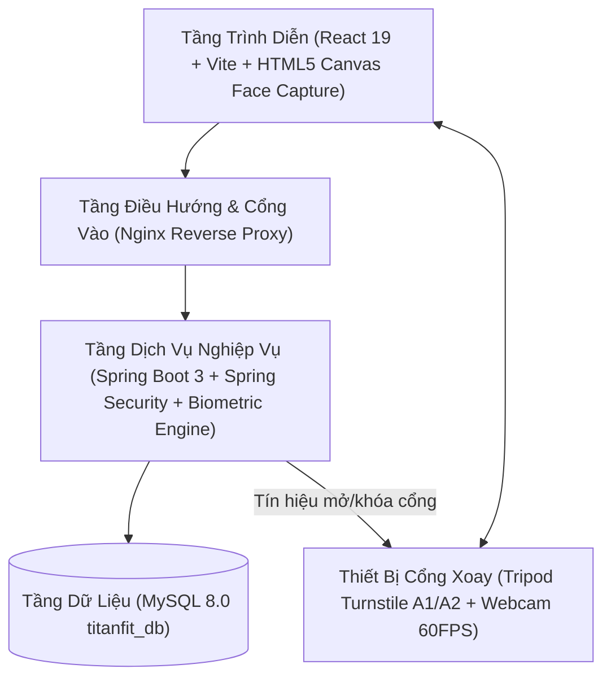
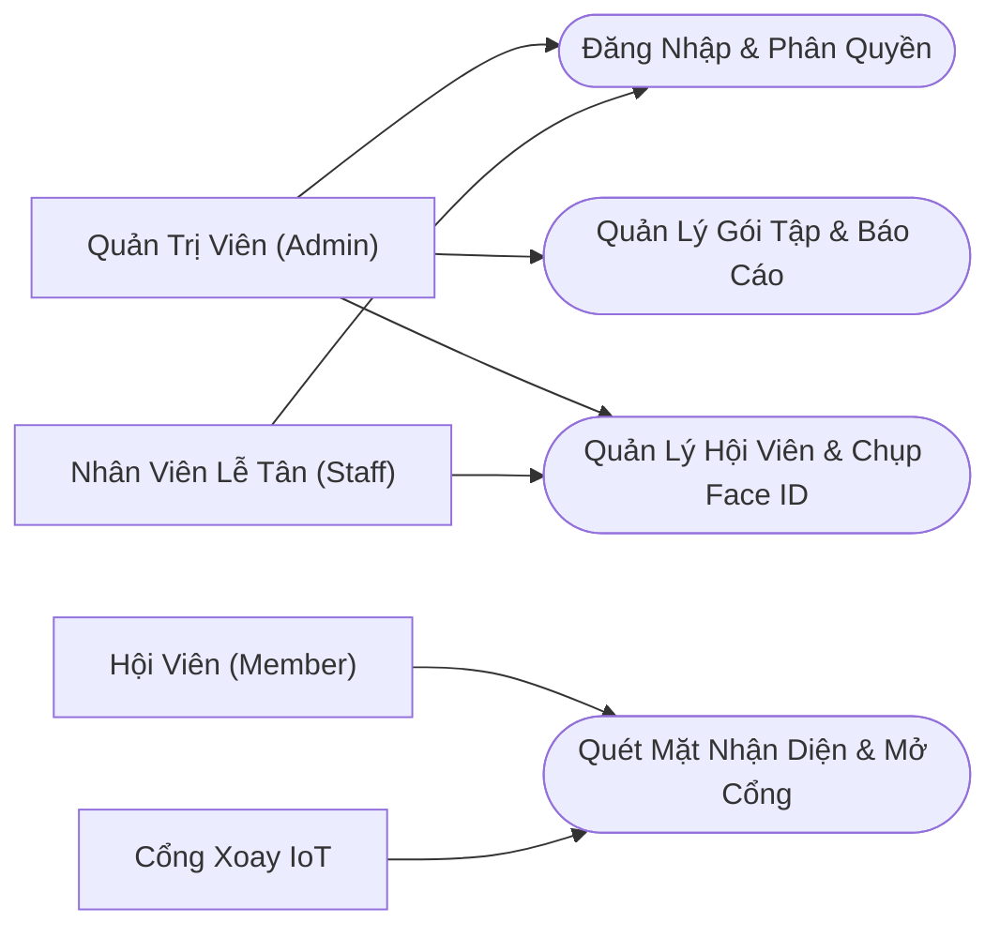
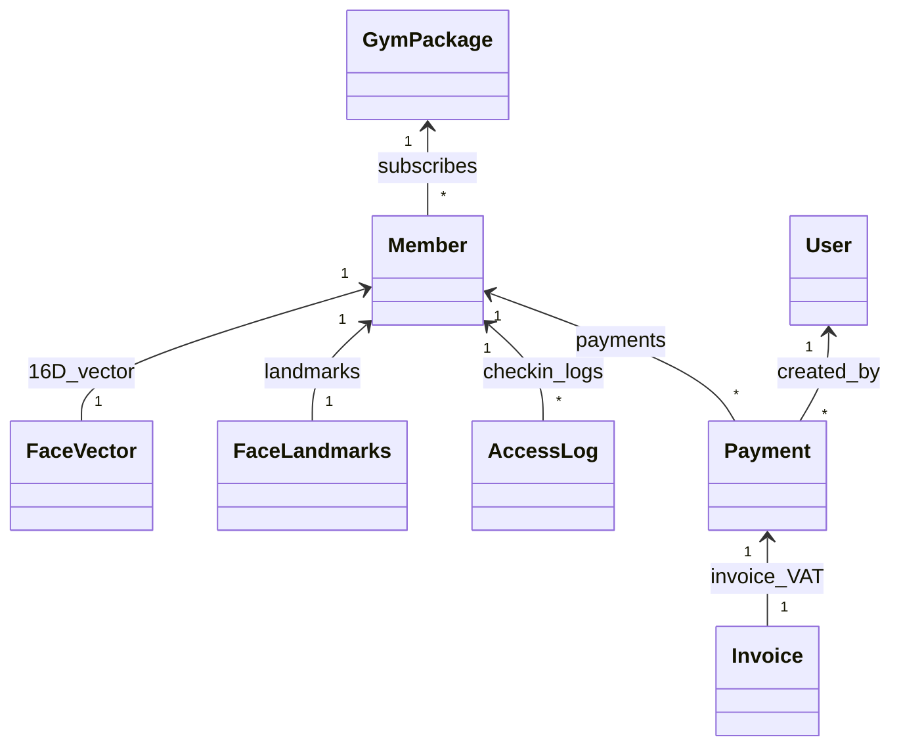

# BÁO CÁO THI GIỮA KỲ — ĐỒ ÁN CHUYÊN NGÀNH PHẦN MỀM (ĐACNPM)

---

## 🏛️ ĐỀ TÀI: TITANFIT BIOMETRICS
### HỆ THỐNG QUẢN LÝ HỘI VIÊN & KIỂM SOÁT RA VÀO PHÒNG GYM BẰNG FACE ID

- **Nhóm sinh viên thực hiện:** **Nhóm 10**
- **Kho lưu trữ GitHub:** [khaind3431-svg/DACNPM-XAY-DUNG-HE-THONG-QUAN-LI-RA-VAO-HOI-VIEN-PHONG-GYM-BANG-FACE-ID](https://github.com/khaind3431-svg/DACNPM-XAY-DUNG-HE-THONG-QUAN-LI-RA-VAO-HOI-VIEN-PHONG-GYM-BANG-FACE-ID)
- **Tài liệu đăng ký đề tài:** [dk_de_tai_nhom_10.docx](../dk_de_tai_nhom_10.docx)

### 👥 Danh Sách Thành Viên Nhóm 10

| STT | Mã Số Sinh Viên (MSSV) | Họ và Tên | Vai Trò / GitHub |
| :---: | :---: | :--- | :--- |
| 1 | `075206003431` | **Nguyễn Đức Khải** | Nhóm trưởng (`khaind3431-svg`) |
| 2 | `066206005759` | **Lê Như Hoàng** | Thành viên (`HoangLN714`) |
| 3 | `087206015150` | **Nguyễn Công Tấn** | Thành viên (`tannc5150-svg`) |
| 4 | `089206000099` | **Nguyễn Khắc Anh Tân** | Thành viên |
| 5 | `067206000218` | **Vương Đình Minh** | Thành viên (`minhlamcoder`) |

---

## 📑 MỤC LỤC NỘI DUNG BÁO CÁO GIỮA KỲ

1. [Phần 1: Kiến Trúc Hệ Thống (System Architecture)](./1_Kien_Truc_He_Thong.md)
   - 1.1. Tổng quan kiến trúc đa tầng (Multi-Tier Architecture)
   - 1.2. Sơ đồ kiến trúc phân tầng (Mermaid Diagram)
   - 1.3. Mô tả chi tiết 5 tầng: Client (React 19), Reverse Proxy (Nginx), Backend (Spring Boot 3), Persistence (MySQL 8), Hardware IoT (Cổng xoay & Webcam)
2. [Phần 2: Lược Đồ Use Case (Use Case Diagram)](./2_Luoc_Do_UseCase.md)
   - 2.1. Danh sách và vai trò 4 tác nhân (Actors): Admin (Dual-Admin), Staff, Member, Gate IoT
   - 2.2. Sơ đồ Use Case tổng thể toàn hệ thống
   - 2.3. Phân rã 4 phân hệ Use Case chi tiết (17 Use Cases)
   - 2.4. Bảng đặc tả chi tiết 3 Use Case cốt lõi: UC10 (Quét Face ID mở cổng), UC04 (Đăng ký hội viên & quét mặt), UC01 (Đăng nhập phân quyền)
3. [Phần 3: Lược Đồ Lớp (Class Diagram)](./3_Luoc_Do_Lop.md)
   - 3.1. Tổng quan mô hình hướng đối tượng phân lớp (OOP Layered Model)
   - 3.2. Sơ đồ Lược đồ Lớp UML tổng thể (Entities, Services, Controllers, Enums)
   - 3.3. Đặc tả chi tiết các lớp thực thể cốt lõi (`Member`, `FaceVector`, `AccessLog`, `GymPackage`, `User`)
   - 3.4. Các lớp dịch vụ giải thuật sinh trắc học (`GateAccessService`, `BiometricService`, `MemberService`, `AuthService`)

---

## 🎯 BẢNG TỔNG HỢP CÁC SƠ ĐỒ KỸ THUẬT

### 1. Sơ Đồ Kiến Trúc Hệ Thống Nhanh

### 2. Sơ Đồ Use Case Rút Gọn

### 3. Sơ Đồ Thực Thể Quan Hệ Cốt Lõi (Entity Relationships)

---

> 📂 **Xem chi tiết từng phần báo cáo tại các file liên kết phía trên.**  
> File tài liệu được định dạng Markdown chuẩn GitHub Flavored Markdown (GFM), hỗ trợ xem trực tiếp trên GitHub hoặc xuất sang định dạng Word/PDF.
